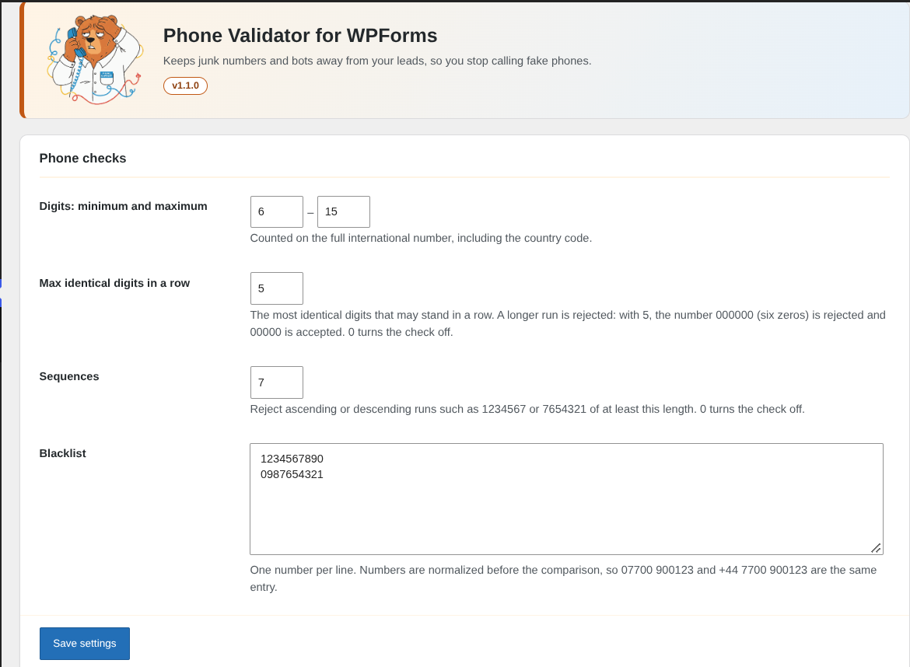
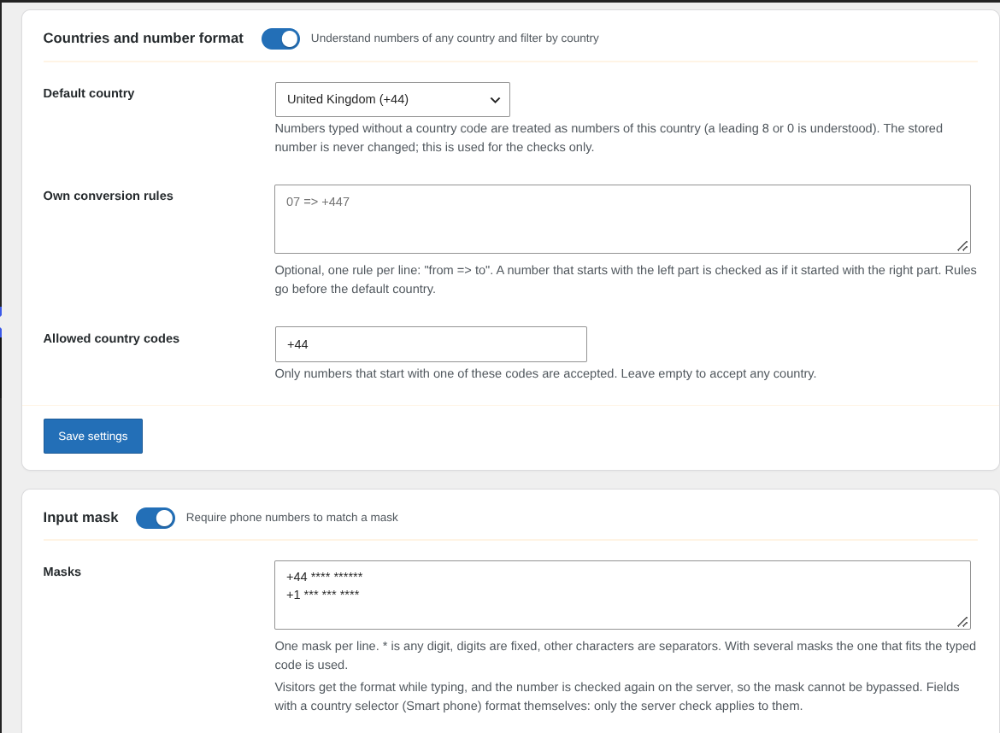
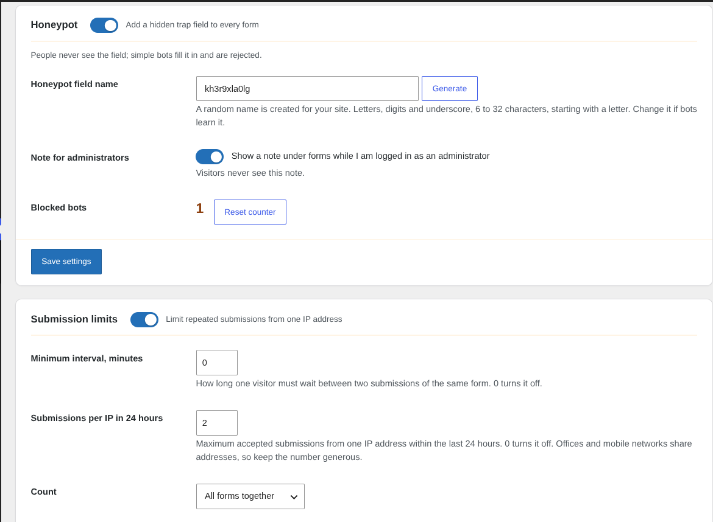
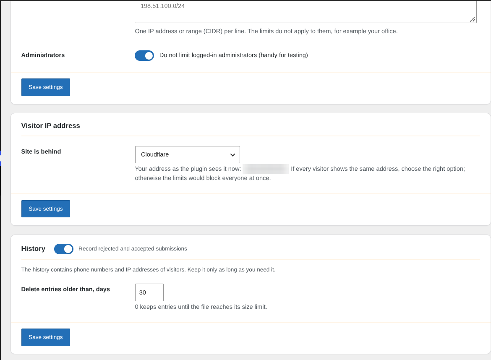
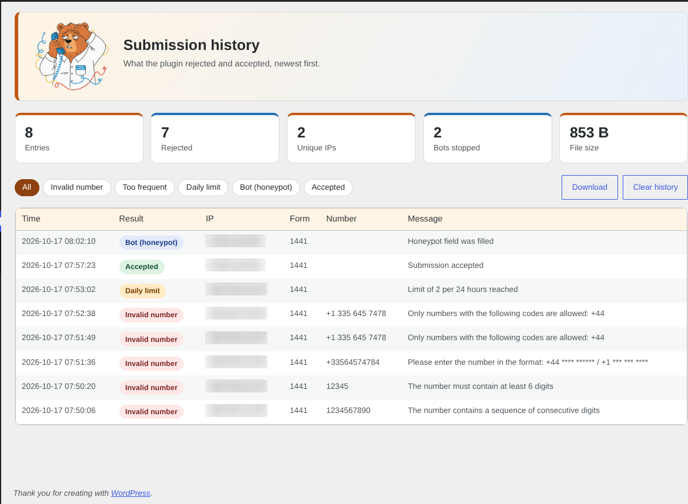

# Phone Validator for WPForms

Stops junk phone numbers and bots in **WPForms** (Lite and Pro): number checks for any country, input mask, honeypot, per-IP limits and a submission history.


Available on WordPress.org: <https://wordpress.org/plugins/phone-validator-for-wpforms/>

## Screenshots

| | |
|---|---|
| <br>Phone checks: digits, repeats, sequences, blacklist | <br>Countries, number format and input mask |
| <br>Honeypot and submission limits | <br>Visitor IP detection and history retention |
| <br>History of rejected and accepted submissions | |

## Why

Paid traffic brings leads and junk: `1111111`, random digits, bots. The plugin filters them out before they reach your inbox or CRM. Install, activate, done: the defaults work out of the box.

## Features

- **Phone rules:** minimum and maximum length, identical digits in a row, ascending and descending sequences, own blacklist.
- **Any country:** numbers are understood in national and international form (`020 7946 0958`, `+44 20 7946 0958`, `0044 20 7946 0958`). Default country, own rules like `07 => +447`, built-in table of calling codes and lengths. Stored numbers are never modified.
- **Allowed country codes:** accept only the countries you serve (`+1, +44, +33, +34`).
- **Input mask:** `+1 *** *** ****` formats the field while typing; the server checks the number again, so the mask cannot be bypassed.
- **Honeypot:** invisible field with a random per-site name (editable), blocked bots counter, note under forms visible to logged-in administrators only.
- **Limits per IP:** minimum interval and N submissions per 24 hours, all forms together or per form, trusted IPs, administrators excluded.
- **Correct IP behind Cloudflare and proxies:** Cloudflare built in, other proxies via a trusted list.
- **History:** filter, paging, download, automatic cleanup. Stored in a protected file with a random name.

## Notes

- The mask is applied while typing to plain phone fields. WPForms *Smart* phone fields (country selector) format themselves; the server check still applies.
- Everything that protects the form is verified on the server; nothing depends on JavaScript.
- The history contains phone numbers and IP addresses. It can be turned off, old entries are removed automatically (30 days by default).

## Requirements

WordPress 5.6+, PHP 7.4+, WPForms 1.6+ (Lite or Pro).

## Installation

1. Install and activate WPForms (Lite or Pro).
2. Copy the `phone-validator-for-wpforms` folder to `wp-content/plugins/` and activate the plugin.
3. Open **Phone Validator → Settings** and check the default country.

## Developers

Settings are read through `WPFPV_Settings::get( $form_id )`, which passes the result through the `wpfpv_settings` filter, so they can be overridden per form:

```php
add_filter( 'wpfpv_settings', function ( $settings, $form_id ) {
	if ( 12 === $form_id ) {
		$settings['allowed_country_codes'] = '+49';
	}
	return $settings;
}, 10, 2 );
```

Other filters: `wpfpv_cloudflare_ranges`, `wpfpv_log_max_size`.

## Support

Found a bug or have a question? Write on Telegram: [@advertsales](https://t.me/advertsales), open an [issue](https://github.com/Ilyntiy/phone-validator-for-wpforms/issues) here, or post on the [WordPress.org support forum](https://wordpress.org/support/plugin/phone-validator-for-wpforms/).

## Credits

The country calling code and number length table is generated from the open [libphonenumber](https://github.com/google/libphonenumber) metadata (Apache License 2.0).

## Changelog

### 1.1.0
- New: per-IP limit in 24 hours, trusted IPs.
- New: input mask with server-side re-check.
- New: honeypot with random field name, counter and administrator note.
- New: number normalization for all countries, default country, own rules.
- New: ascending/descending sequence check.
- New: correct visitor IP behind Cloudflare and proxies.
- New: history filter, paging, download; redesigned screens.
- New: Support link on the Plugins screen and a support line at the bottom of the plugin pages.
- Improved: protected history file with random name, size limit, safe cleanup.
- Fixed: a number in national form (`07700 900123`) rejected when only `+44` was allowed; history forging with line breaks; uninstall left the history folder.

### 1.0.1
- Fixed: correct IPv6 address counting in logging.

### 1.0.0
- Initial release.

## License

GPL v2 or later. See [LICENSE](LICENSE).
